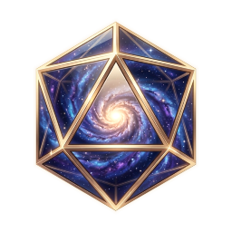

<p align="center">
  
</p>

<h1 align="center">TTG Universe</h1>

<p align="center">
  <b>A home for your tabletop role-playing characters.</b><br>
  Character sheets, campaigns and dice — in one native Windows app.
</p>

<p align="center">
  <a href="../../releases"></a>
  <a href="../../releases"></a>
  
  
</p>

<p align="center">
  <a href="https://ttg-universe.party"><b>Website</b></a> ·
  <a href="../../releases"><b>Download</b></a> ·
  <a href="mailto:support@ttg-universe.party"><b>Support</b></a>
</p>

---

## ✨ Features

| | |
|---|---|
| 🎲 **Three systems** | **Project Capella** (fantasy, mutations, magic), **Project Menkar** (demons, contracts, currencies) and **DnD 5E** based on SRD 5.1 — full sheets with calculations, dice rolls, inventory and a journal. |
| 🏰 **Campaigns** | The master runs the table: invites players, sees their sheets, applies damage, healing and items, keeps the turn order. |
| ☁️ **Cloud or this PC — per sheet** | Founders sync characters across devices. Every sheet can live in the cloud or stay only on your computer; switch with one click. Without an account everything works offline. |
| 🔗 **Sheet sharing** | Send a `ttg://` link that opens right in the app, or a `.ttgsheet` file. |
| 📖 **Knowledge base** | The Capella rules inside the app, with search and contents. Works offline. |
| 🛡️ **Your account, your control** | Sign-in with an authenticator app code, data export, and account deletion in the app with 30 days to change your mind. |

## 📥 Install

1. Open **[Releases](../../releases)** and download `TTG-Universe-Setup-<version>.exe`.
2. Run it. No administrator rights needed. You choose where the app goes and where your characters are kept; uninstalling never touches your characters.
3. Prefer no installer? Take the portable `.zip`, extract it anywhere and run `TTG Universe.exe`.

**Requirements:** Windows 10 version 2004 (build 19041) or later, or Windows 11, 64-bit.

> [!NOTE]
> The build is not code-signed yet, so Windows SmartScreen may say *"Windows protected your PC"*. Verify the file (below), then choose **More info** → **Run anyway**.

### 🔐 Verify the download

Every file in a release has a `.sha256` next to it, and the hashes are also listed in the release notes. In PowerShell:

```powershell
(Get-FileHash .\TTG-Universe-Setup-<version>.exe -Algorithm SHA256).Hash
```

The result must match the published hash exactly.

## 🧪 Beta

TTG Universe is in **open beta**. Things may break — tell us and we fix them fast. Bug reports, ideas and questions: **support@ttg-universe.party**.

This repository holds **releases only**; the source code is not published here.

## 📜 Licences

The DnD 5E rules are based on the System Reference Document 5.1 by Wizards of the Coast LLC, licensed under [Creative Commons Attribution 4.0](https://creativecommons.org/licenses/by/4.0/legalcode). This work includes material taken from the System Reference Document 5.1 by Wizards of the Coast LLC, available at <https://dnd.wizards.com/resources/systems-reference-document>. TTG Universe is not affiliated with or endorsed by Wizards of the Coast.

<p align="center"><sub>Made with 🎲 for tabletop players · <a href="https://ttg-universe.party">ttg-universe.party</a></sub></p>
